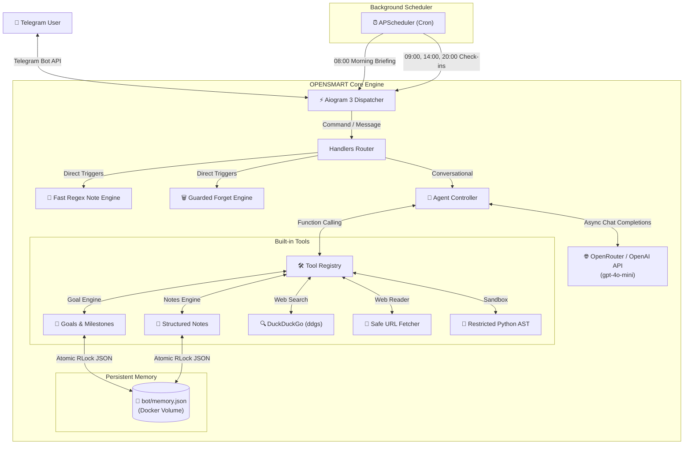

<p align="center">
  
</p>

<h1 align="center">OPENSMART</h1>

<p align="center">
  <strong>The fastest, smartest, and most resource-efficient open-source Telegram AI assistant.</strong><br/>
  Runs 24/7 on a 512 MB VPS for $2/mo · Long-term Goal Planning · Smart Notes · Daily Briefings · Deep Focus
</p>

<p align="center">
  <a href="https://github.com/erbulanbombi-ux/OPENSMART"></a>
  <a href="https://python.org"></a>
  <a href="https://core.telegram.org/bots"></a>
  <a href="https://docker.com"></a>
  <a href="./LICENSE"></a>
  <a href="#"></a>
</p>

<p align="center">
  <a href="#-quick-install">Quick Install</a> ·
  <a href="#-why-opensmart">Why OPENSMART?</a> ·
  <a href="#-the-identity--logo">Brand & Logo</a> ·
  <a href="#-features-walkthrough">Features</a> ·
  <a href="#-comparison">Comparison</a> ·
  <a href="#-command-reference">Commands</a> ·
  <a href="#-architecture">Architecture</a>
</p>

---

> [!NOTE]
> 🚀 **Built for Hackathons & 24/7 Production Deployment.**
> OPENSMART is an autonomous personal AI companion designed to solve the real-life productivity bottleneck: breaking down ambitious long-term goals into verifiable milestones, capturing spontaneous ideas without friction, and keeping you accountable daily — all while consuming less than 80 MB RAM.

---

## ⚡ Quick Install

### Option A: 🐳 Docker Compose (Recommended)

Deploy OPENSMART anywhere in under 60 seconds with one command:

```bash
# 1. Clone the repository
git clone https://github.com/erbulanbombi-ux/OPENSMART.git
cd OPENSMART

# 2. Configure your environment
cp .env.example .env
nano .env  # Add your BOT_TOKEN and OPENROUTER_API_KEY

# 3. Start the container in background
docker compose up -d --build
```

To inspect live logs:
```bash
docker compose logs -f
```

---

### Option B: 🐍 Local Python 3.11+ Setup

```bash
# 1. Clone and create virtual environment
git clone https://github.com/erbulanbombi-ux/OPENSMART.git
cd OPENSMART
python3 -m venv .venv

# 2. Activate virtual environment
source .venv/bin/activate       # Linux/macOS
.\.venv\Scripts\Activate.ps1    # Windows PowerShell

# 3. Install dependencies
pip install -r requirements.txt

# 4. Configure .env
cp .env.example .env
# Edit BOT_TOKEN and OPENROUTER_API_KEY in .env

# 5. Launch OPENSMART
python3 -m bot.main
```

---

## 🎨 The Identity & Logo

<p align="center">
  
</p>

The **OPENSMART** avatar and visual language were created to embody the core philosophy of unlocked human potential and focused intelligence:

* 🗝️ **The Monolith Keyhole (`OPEN`)**: Symbolizes unlocking hidden cognitive potential, solving complex obstacles, and gaining access to clear thinking. It also reflects uncompromising privacy and security: your goals and personal notes are kept strictly protected.
* 👑 **The Starburst Crown (`SMART`)**: Represents ambition, strategic vision, and reaching peak performance across education, athletic pursuits, startups, and personal projects.
* ⭕ **The Orbital Circle (Focus)**: Represents continuous discipline, daily habits, and the positive feedback loop of incremental progress.
* 🖤 **Minimalist Monochrome Aesthetic**: A stark black-and-white vector design engineered for modern high-tech interfaces. It signals a serious, high-leverage cognitive assistant rather than an ephemeral toy.

---

## 💡 Why OPENSMART?

<table>
<tr>
<td width="50%" valign="top">

### ⚡ Ultra-Lightweight & Fast
Engineered with non-blocking Python `asyncio`, `aiogram 3`, and `httpx`. Consumes **~60 MB RAM at idle** and rarely exceeds 120 MB under heavy load. Operates smoothly on a **512 MB / 0.5 vCPU ($2/month)** server tier.

</td>
<td width="50%" valign="top">

### 🎯 Goal & Milestone Engine (`/tasks`)
Vague goals like *"I want to learn English"* trigger proactive AI-assisted clarification, decomposing your dream into **5 actionable milestones** with visual progress bars (`[████░░░░] 50%`) and verifiable history logs.

</td>
</tr>
<tr>
<td width="50%" valign="top">

### 📝 Frictionless Smart Notes (`/notes`)
Create notes directly from regular messages without rigid commands: `Заметка: Купить книги #учёба` or `Запиши: Идея для стартапа #идеи`. Extracts `#tags`, attaches timestamps, and provides full-text search.

</td>
<td width="50%" valign="top">

### 🛡️ Surgical Deletion Guard (`/forget`)
Say goodbye to accidental data loss. Searching by keyword or ID previews matching items and **strictly requires a `YES` confirmation**. Any other response safely aborts the operation.

</td>
</tr>
<tr>
<td width="50%" valign="top">

### ☀️ Autonomous Daily Digest (`/daily`)
Every morning at 08:00 (or on demand), OPENSMART prioritizes your agenda: calculates **"What to do first"** based on deadlines and goals, surfaces relevant notes, and keeps you on track without notification spam.

</td>
<td width="50%" valign="top">

### ⏱️ Deep Work Accountability (`/focus`)
Built-in Pomodoro/accountability focus sessions (1–180 minutes). Maintains gentle contextual awareness: if you get sidetracked, OPENSMART softly guides you back to your primary task.

</td>
</tr>
</table>

---

## 📊 Comparison

How OPENSMART compares to conventional chatbots and heavy agent frameworks:

| Feature / Metric | Generic Telegram Bot | Heavy Agent Frameworks | Simple Note Bots | OPENSMART 🚀 |
|---|---|---|---|---|
| **RAM Footprint (Idle)** | 150–300 MB | 1.2 GB – 4 GB | 90–150 MB | 🚀 **~60 MB RAM** |
| **Minimum VPS Requirement** | 1–2 GB RAM | 4–8 GB RAM / GPU | 512 MB RAM | 🚀 **512 MB RAM / 0.5 vCPU ($2/mo)** |
| **Goal Decomposition Engine** | 🚫 None | ⚠️ Raw unstructured text | 🚫 None | 🚀 **Automatic 5-stage milestones & progress bars** |
| **Notes from Plain Text** | 🚫 Command-only | ⚠️ Inconsistent | 🚫 Command-only | 🚀 **Dual regex + LLM intent detection** |
| **Safe Deletion Guard** | 🚫 Immediate / No undo | 🚫 None | ⚠️ Simple delete | 🚀 **Search preview + strict `YES` confirmation** |
| **Autonomous Daily Briefing** | 🚫 None | ⚠️ Heavy external cron | 🚫 None | 🚀 **Smart APScheduler (08:00) with priority ranking** |
| **Markdown Resilience** | ⚠️ Fails silently on syntax | ⚠️ Drops response | 🚫 Plain text only | 🚀 **MarkdownV2 with auto-recovery fallback** |
| **One-Click Deploy** | ⚠️ Manual Python setup | ⚠️ Complex dependencies | ⚠️ Manual setup | 🚀 **Docker Compose in 1 command** |

---

## 🛠 Features Walkthrough

### 1. 🎯 Long-Term Goal Management (`/tasks` & `/goals`)
* **Milestone Decomposition**: Creates ordered subtasks with statuses: `⏳` Not started, `🔄` In progress, `✅` Completed.
* **Progress Tracking**: Real-time progress percentage bar `[██████░░] 60%`.
* **Step-by-Step Advancement**: Use `/tasks advance <ID>` to complete the current milestone, record it in history, and unlock the next action.
* **Detailed Goal Cards**: `/tasks view <ID>` shows desired outcomes, deadlines, priority, and full history of finished milestones.

```text
🎯 Цель создана: «Подготовиться к IELTS» [ID: a1b2c3d4]
🏁 Желаемый результат: Сдать на 7.5 баллов через 6 месяцев
📊 Статус: В процессе [██░░░░░░] 20%

Этапы:
  ✅ 1. Пройти диагностический тест и определить уровень
  🔄 2. Сформировать план занятий (30 мин ежедневно)
  ⏳ 3. Освоить Academic Writing Task 1 и Task 2
  ⏳ 4. Провести 10 разговорных сессий с преподавателем
  ⏳ 5. Сдать пробный экзамен на целевой балл

👉 Следующий шаг: Сформировать план занятий
Отметить этап выполненным: /tasks advance a1b2c3d4
```

### 2. 📝 Frictionless Personal Notes (`/notes`)
* **Plain Text Capture**: Send `Заметка: проверить сервер #деплой` or `Запиши: Идея для статьи #блог`.
* **Full-Text & Tag Search**: `/notes search деплой` or `/notes #блог`.
* **Note Cards**: `/notes view <ID>` displays creation date, last updated timestamp, and tags.
* **Inline Editing**: `/notes edit <ID> | Обновлённый текст #новыйтег`.

### 3. 🗑 Surgical Deletion with Guardrails (`/forget`)
* **Targeted Erasure**: Deletes a specific note, goal, or memory entry without wiping your entire conversation history.
* **Search Preview**: Shows the exact record before deletion.
* **Mandatory Confirmation**: Requires typing **`YES`** or **`ДА`**. Any other input safely cancels the deletion.

```text
🔍 Найдена запись для удаления:
• [Заметка] ID: a1b2c3d4
  [2026-10-22] Проверить сервер (#деплой)

⚠️ Для подтверждения отправьте: YES
Любой другой ответ отменит удаление.
```

### 4. ☀️ Morning Briefing & Priorities (`/daily`)
Runs automatically every morning at **08:00** in your configured timezone (`CHECKIN_TIMEZONE`) or on demand via `/daily`:
* 🔥 **What to do first**: Identifies your highest-leverage task based on deadlines and goal priorities.
* ⏰ **Imminent Deadlines**: Highlights urgent reminders and due dates.
* 🎯 **Active Goals**: Displays current milestones and progress.
* 💡 **Contextual Notes**: Surfaces relevant thoughts and ideas.

### 5. ⏱ Deep Focus Session (`/focus`)
* `/focus 25` — Starts a 25-minute distraction-free focus block.
* Context-aware encouragement: if you start chatting during a focus session, the assistant gently nudges you back to the task at hand.
* `/focus stop` — Ends the timer early.

---

## 📋 Command Reference

| Command | Description | Example Usage |
|---|---|---|
| `/start` | Welcome message and quick start guide | `/start` |
| `/tasks` | List active goals with progress bars and milestones | `/tasks` |
| `/tasks add` | Create goal with optional desired outcome | `/tasks add Английский \| Уровень B2` |
| `/tasks advance <ID>` | Complete current milestone and advance progress | `/tasks advance a1b2c3` |
| `/tasks view <ID>` | View detailed goal card with full milestone history | `/tasks view a1b2c3` |
| `/tasks pause <ID>` | Pause an active goal | `/tasks pause a1b2c3` |
| `/tasks resume <ID>` | Resume a paused goal | `/tasks resume a1b2c3` |
| `/tasks done <ID>` | Complete an entire goal early (100%) | `/tasks done a1b2c3` |
| `/notes` | View all saved notes with tags and dates | `/notes` |
| `/notes add <text>` | Add note with hashtags | `/notes add Идея для приложения #стартап` |
| `/notes view <ID>` | View specific note with creation and update dates | `/notes view a1b2c3` |
| `/notes edit <ID> \| <text>` | Edit note text and tags | `/notes edit a1b2c3 \| Новый текст #тег` |
| `/notes search <query>` | Search notes by text or tag | `/notes search стартап` |
| `/forget <query>` | Safely find and delete a note or memory with `YES` | `/forget стартап` |
| `/daily` | Generate immediate daily briefing and priorities | `/daily` |
| `/focus <min>` | Start deep work timer (1–180 minutes) | `/focus 25` |
| `/focus stop` | Stop active focus session | `/focus stop` |
| `/new` | Clear conversation context | `/new` |
| `/memory` | Inspect active conversation turns | `/memory` |
| `/tools` | List enabled tools and schema capabilities | `/tools` |
| `/help` | Complete help guide | `/help` |

---

## 🏗 Architecture



---

## ⚙️ Configuration (`.env`)

| Variable | Required | Default | Description |
|---|:---:|---|---|
| `BOT_TOKEN` | **Yes** | — | Telegram Bot API token from [@BotFather](https://t.me/BotFather) |
| `OPENROUTER_API_KEY` | **Yes** | — | API key from [OpenRouter](https://openrouter.ai/) or OpenAI |
| `LLM_MODEL` | No | `openai/gpt-4o-mini` | LLM model identifier (supports any OpenAI-compatible model) |
| `LLM_BASE_URL` | No | `https://openrouter.ai/api/v1` | Base URL for LLM API requests |
| `CHECKIN_TIMEZONE` | No | `UTC` | IANA timezone (e.g. `Europe/Moscow`, `Asia/Almaty`) |
| `CHECKIN_HOURS` | No | `9,14,20` | Comma-separated hours for proactive check-ins |
| `OPENSMART_MEMORY_PATH` | No | `bot/memory.json` | Custom path to memory storage file |

---

## 🤝 Contributing

Contributions, issues, and feature suggestions are welcome!

1. Fork the repository.
2. Create your feature branch (`git checkout -b feat/amazing-feature`).
3. Commit your changes (`git commit -m 'feat: add amazing feature'`).
4. Push to the branch (`git push origin feat/amazing-feature`).
5. Open a Pull Request.

---

## 📄 License

This project is licensed under the **MIT License** — see the [LICENSE](./LICENSE) file for details.

<p align="center">
  <b>Built with ❤️ for focused minds and high achievers.</b><br/>
  <sub>OPENSMART — Unlock your potential.</sub>
</p>
