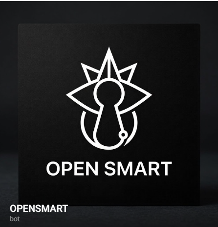

<p align="center">
  
</p>

<h1 align="center">OPENSMART</h1>

<p align="center">
  <strong>The fastest, smartest, and most resource-efficient open-source Telegram AI assistant.</strong><br/>
  Powered by OpenRouter & OpenAI · Runs 24/7 on a 512 MB VPS for $2/mo · Long-term Goal Planning · Smart Notes · Daily Briefings · Deep Focus
</p>

<p align="center">
  <a href="https://openrouter.ai"></a>
  <a href="https://github.com/erbulanbombi-ux/OPENSMART"></a>
  <a href="https://python.org"></a>
  <a href="https://core.telegram.org/bots"></a>
  <a href="https://docker.com"></a>
  <a href="./LICENSE"></a>
  <a href="#"></a>
</p>

<p align="center">
  <a href="#-quick-install">Quick Install</a> ·
  <a href="#-why-opensmart">Why OPENSMART?</a> ·
  <a href="#-the-identity--logo">Brand & Logo</a> ·
  <a href="#-features-walkthrough">Features</a> ·
  <a href="#-comparison">Comparison</a> ·
  <a href="#-command-reference">Commands</a> ·
  <a href="#-architecture">Architecture</a>
</p>

---

> [!NOTE]
> 🚀 **Built for 24/7 Production Deployment.**
> OPENSMART is an autonomous personal AI companion powered by **OpenRouter & OpenAI** (`openai/gpt-4o-mini`). It solves the real-life productivity bottleneck: breaking down ambitious long-term goals into verifiable milestones, capturing spontaneous ideas without friction, and keeping you accountable daily — all while consuming less than 80 MB RAM.

---

## ⚡ Quick Install

### Option A: 🐳 Docker Compose (Recommended)

Deploy OPENSMART anywhere in under 60 seconds with one command:

```bash
# 1. Clone the repository
git clone https://github.com/erbulanbombi-ux/OPENSMART.git
cd OPENSMART

# 2. Configure your environment
cp .env.example .env
nano .env  # Add your BOT_TOKEN and OPENROUTER_API_KEY

# 3. Start the container in background
docker compose up -d --build
```

To inspect live logs:
```bash
docker compose logs -f
```

---

### Option B: 🐍 Python Virtual Environment

```bash
# 1. Clone and enter repo
git clone https://github.com/erbulanbombi-ux/OPENSMART.git
cd OPENSMART
python3 -m venv .venv

# 2. Activate virtual environment
source .venv/bin/activate       # Linux/macOS
.\.venv\Scripts\Activate.ps1    # Windows PowerShell

# 3. Install dependencies
pip install -r requirements.txt

# 4. Configure .env
cp .env.example .env
# Edit BOT_TOKEN and OPENROUTER_API_KEY in .env

# 5. Launch OPENSMART
python3 -m bot.main
```

---

## 🎨 The Identity & Logo

<p align="center">
  
</p>

The **OPENSMART** avatar and visual language were created to embody the core philosophy of unlocked human potential and focused intelligence:

* 🗝️ **The Monolith Keyhole (`OPEN`)**: Symbolizes unlocking hidden cognitive potential, solving complex obstacles, and gaining access to clear thinking. It also reflects uncompromising privacy and security: your goals and personal notes are kept strictly protected.
* 👑 **The Starburst Crown (`SMART`)**: Represents ambition, strategic vision, and reaching peak performance across education, athletic pursuits, startups, and personal projects.
* ⭕ **The Orbital Circle (Focus)**: Represents continuous discipline, daily habits, and the positive feedback loop of incremental progress.
* 🖤 **Minimalist Monochrome Aesthetic**: A stark black-and-white vector design engineered for modern high-tech interfaces. It signals a serious, high-leverage cognitive assistant rather than an ephemeral toy.

---

## 💡 Why OPENSMART?

<table>
<tr>
<td width="50%" valign="top">

### ⚡ Ultra-Lightweight & Fast
Engineered with non-blocking Python `asyncio`, `aiogram 3`, and `httpx`. Backed by fast, reliable LLM providers. Consumes **~60 MB RAM at idle** and rarely exceeds 120 MB under heavy load. Operates smoothly on a **512 MB / 0.5 vCPU ($2/month)** server tier.

</td>
<td width="50%" valign="top">

### 🎯 Goal & Milestone Engine (`/tasks`)
Vague goals like *"I want to learn English"* trigger proactive AI-assisted clarification, decomposing your dream into **5 actionable milestones** with visual progress bars (`[████░░░░] 50%`) and verifiable history logs.

</td>
</tr>
<tr>
<td width="50%" valign="top">

### 📝 Frictionless Smart Notes (`/notes`)
Create notes directly from regular messages without rigid commands: `Note: Buy books #study` or `Save: Mobile app idea #startup`. Extracts `#tags`, attaches timestamps, and provides full-text search.

</td>
<td width="50%" valign="top">

### 🛡️ Surgical Deletion Guard (`/forget`)
Say goodbye to accidental data loss. Searching by keyword or ID previews matching items and **strictly requires a `YES` confirmation**. Any other response safely aborts the operation.

</td>
</tr>
<tr>
<td width="50%" valign="top">

### ☀️ Autonomous Daily Digest (`/daily`)
Receive morning briefings and proactive check-ins at 09:00, 14:00, and 20:00 (fully customizable via cron). Evaluates upcoming deadlines, recommends what to tackle first, and keeps momentum alive.

</td>
<td width="50%" valign="top">

### ⏱️ Deep Work Accountability (`/focus`)
Start Pomodoro-style focus intervals (`/focus 25`). If you get sidetracked during an active session, the assistant gently nudges you back onto your chosen priority with calm discipline.

</td>
</tr>
</table>

---

## 📊 Comparison

| Feature | Typical Telegram Bots | Local LLM Agents (Ollama) | SaaS Note Apps | 🚀 **OPENSMART** |
|---|---|---|---|---|
| **Memory Footprint** | 200–500 MB | 4–16 GB RAM | Web browser / Electron | **~60 MB RAM** |
| **Minimum Hardware** | 1 vCPU / 1 GB RAM | High-end GPU / M-Series | Cloud subscription | **0.5 vCPU / 512 MB RAM** |
| **Hosting Cost** | $7–$20 / mo | Expensive local rig | $10–$25 / user / mo | **~$2 / mo VPS or Free Tier** |
| **Goal Milestones** | Simple to-do list | Unstructured conversation | Rigid manual hierarchy | **Autonomous AI decomposition** |
| **Data Safety** | Accidental overwrites | Lost upon session restart | Vendor lock-in | **Guarded `YES` confirmation** |
| **Proactive Check-ins** | None | None | Push notification spam | **Context-aware cron schedule** |
| **Interface** | Bot menus / WebUI | Terminal only | Mobile / Desktop app | **Everywhere in Telegram** |

---

## 📋 Command Reference

| Command | Description | Example Usage |
|---|---|---|
| `/start` | Welcome message and quick start guide | `/start` |
| `/tasks` | List active goals with progress bars and milestones | `/tasks` |
| `/tasks add` | Create goal with optional desired outcome | `/tasks add Learn Spanish \| Level B2 in 6 months` |
| `/tasks advance <ID>` | Complete current milestone and advance progress | `/tasks advance a1b2c3` |
| `/tasks view <ID>` | View detailed goal card with full milestone history | `/tasks view a1b2c3` |
| `/tasks pause <ID>` | Pause an active goal | `/tasks pause a1b2c3` |
| `/tasks resume <ID>` | Resume a paused goal | `/tasks resume a1b2c3` |
| `/tasks done <ID>` | Complete an entire goal early (100%) | `/tasks done a1b2c3` |
| `/notes` | View all saved notes with tags and dates | `/notes` |
| `/notes add <text>` | Add note with hashtags | `/notes add Idea for mobile app #startup` |
| `/notes view <ID>` | View specific note with creation and update dates | `/notes view a1b2c3` |
| `/notes edit <ID> \| <text>` | Edit note text and tags | `/notes edit a1b2c3 \| Updated text #new` |
| `/notes search <query>` | Search notes by text or tag | `/notes search startup` |
| `/forget <query>` | Safely find and delete a note or memory with `YES` | `/forget startup` |
| `/daily` | Generate immediate daily briefing and priorities | `/daily` |
| `/focus <min>` | Start deep work timer (1–180 minutes) | `/focus 25` |
| `/focus stop` | Stop active focus session | `/focus stop` |
| `/new` | Clear conversation context | `/new` |
| `/memory` | Inspect active conversation turns | `/memory` |
| `/tools` | List enabled tools and schema capabilities | `/tools` |
| `/help` | Complete help guide | `/help` |

---

## 🏗 Architecture


---

## ⚙️ Configuration (`.env`)

| Variable | Required | Default | Description |
|---|:---:|---|---|
| `BOT_TOKEN` | **Yes** | — | Telegram Bot API token from [@BotFather](https://t.me/BotFather) |
| `OPENROUTER_API_KEY` | **Yes** | — | OpenRouter API key from [OpenRouter](https://openrouter.ai) |
| `OPENAI_API_KEY` | Optional | — | Direct OpenAI API key from [OpenAI](https://platform.openai.com) |
| `CHECKIN_TIMEZONE` | No | `UTC` | IANA timezone (e.g. `UTC`, `America/New_York`, `Asia/Tokyo`) |
| `CHECKIN_HOURS` | No | `9,14,20` | Comma-separated hours for proactive check-ins |
| `OPENSMART_MEMORY_PATH` | No | `bot/memory.json` | Custom path to memory storage file |

---

## 🤝 Contributing

Contributions, issues, and feature suggestions are welcome!

1. Fork the repository.
2. Create your feature branch (`git checkout -b feat/amazing-feature`).
3. Commit your changes (`git commit -m 'feat: add amazing feature'`).
4. Push to the branch (`git push origin feat/amazing-feature`).
5. Open a Pull Request.

---

## 📄 License

This project is licensed under the **MIT License** — see the [LICENSE](./LICENSE) file for details.

<p align="center">
  <b>Built with ❤️ for focused minds and high achievers.</b><br/>
  <sub>OPENSMART — Unlock your potential.</sub>
</p>
